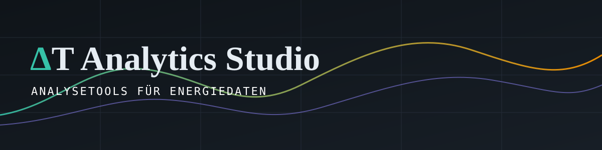

<div align="center">



# ΔT Analytics Studio

**Browserbasierte Trendanalyse für Energie-, Heizungs- und Wärmepumpen-Audits.**
Python im Browser, keine Installation, keine Server, keine Daten verlassen den Rechner.

[**▶ Live-Demo**](https://DEIN-USER.github.io/deltat-analytics-studio/) · [Features](#features) · [Architektur](#architektur) · [Datenschutz](#daten--datenschutz)


</div>

---

## Was ist das?

Das **ΔT Analytics Studio** ist das Analyse-Werkzeug hinter [ΔT Analytics](#über-das-projekt): Zählerdaten (Gas, Wärme, Strom) einer Anlage werden importiert, bereinigt, als Anlagen-Topologie (Erzeuger → Verteiler → Verbraucher) abgebildet und zu Trends, Plausibilitätsprüfungen und einem Kundenbericht verarbeitet.

Die gesamte Rechenlogik ist Python (pandas, numpy), läuft per [Pyodide](https://pyodide.org) direkt im Browser. Die Oberfläche ist eine einzelne HTML-Datei.

Diese Demo startet im **Engineering-Modus** (schreibgeschützt) mit einem **anonymisierten Beispielprojekt** – 5 Jahre stündliche Gasverbrauchsdaten, Anlage mit zwei Kesseln, Pufferspeicher und vier Verbrauchern.

## Features

| Bereich | Inhalt |
|---|---|
| **Projekte** | Mehrere Projekte, lokal im Browser (IndexedDB), Export/Import als Projektdatei |
| **Messpunkte** | Rollen *Produzent*, *Verteiler* (z. B. Pufferspeicher mit Volumen), *Verbraucher*; Mengenzuordnung zwischen Knoten |
| **Import** | CSV (inkl. Netzbetreiber-Lastgänge mit Kopfzeilen) und Excel; interaktive Spaltenzuordnung, manuelle Zusatzspalten |
| **Aufbereitung** | Zeitraster-Erkennung, Bereinigung, Resampling auf einheitliches Grid |
| **Analysen** | Energie-/Leistungsverläufe, Wirkungsgrad-Ansatz, Trendvergleiche projektweit |
| **Wetterbezug** | Außentemperatur, rel. Feuchte, Niederschlag aus GeoSphere-Austria-Klimadaten (10-min) |
| **Plausibilität** | Projektweite Prüfung der Messreihen und Bilanzen |
| **Befunde** | Priorisierte Befunde (hoch/mittel/niedrig, Status offen → umgesetzt) mit Empfehlung |
| **Bericht** | Kurz- und Vollbericht als PDF, Daten-Export als CSV-ZIP / Excel |
| **Engineering-HTML** | Das komplette Projekt als eigenständige, read-only HTML-Datei exportierbar |

## Architektur

```
Browser
├── index.html            UI (Vanilla JS) + eingebettetes Projekt (JSON)
├── Pyodide               Python-Laufzeit im Browser (WASM)
│   └── deltat/           eigenes Python-Paket
│       ├── core/         parsing · cleaning · mapping · zeitraster · topology
│       │                 analysis · plotting · validierung · wetter · befunde
│       │                 bericht · excel · export
│       └── models/       schema
├── Plotly                interaktive Diagramme
└── pdfmake               PDF-Berichte
```

- **Single-File**: UI, Python-Paket und Projektdaten in einer HTML-Datei → trivial zu verteilen (E-Mail, USB, Pages).
- **Clientseitig**: keine Backend-Kosten, keine Daten-Uploads.
- **Externe Abhängigkeiten** (CDN): Pyodide, Plotly, pdfmake, Google Fonts; Wetterdaten live von GeoSphere Austria.

## Lokal ausprobieren

```bash
git clone https://github.com/DEIN-USER/deltat-analytics-studio.git
cd deltat-analytics-studio
python -m http.server 8000      # dann http://localhost:8000
```

Internetzugang nötig (CDNs, Wetter-API). Erster Start lädt Pyodide (~10 MB) – danach gecacht.

## Deployment (GitHub Pages)

`Settings → Pages → Source: Deploy from a branch → main / (root)`. Die Datei `.nojekyll` verhindert die Jekyll-Verarbeitung.

## Daten & Datenschutz

Alle Beispieldaten sind **anonymisiert**: Objekt-, Straßen- und Zählpunktbezeichnungen sind entfernt bzw. maskiert. Die Verarbeitung findet ausschließlich lokal im Browser statt.

## Über das Projekt

ΔT Analytics ist eine Solo-Beratung für Energiedatenanalyse bei industriellen Wärmepumpen- und HVAC-Anlagen – von Sebastian Sonderegger, Wien (BSc Artificial Intelligence, JKU Linz).

## Lizenz

© 2026 Sebastian Sonderegger. Alle Rechte vorbehalten – Showcase zur Ansicht, siehe [LICENSE](LICENSE).
